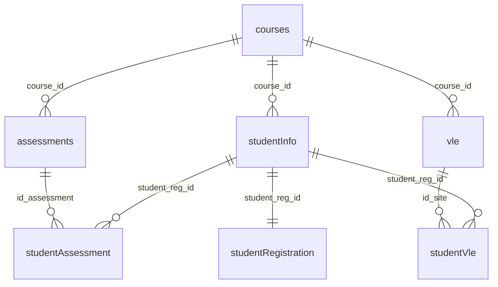

# OULAD Relational Prediction Tasks: Proposal & Feasibility Report

This report evaluates **four candidate relational prediction tasks** designed over the Open University Learning Analytics Dataset (**OULAD**), structured according to the **RelBench** benchmark specifications and Homework 1 requirements.

---

## 1. Relational Schema Architecture

The OULAD database is structured into **7 relational tables** linked by single-column foreign-to-primary key relationships with continuous integer primary keys ($0 \dots n-1$):



### Table Summary & Data Scale
- **`courses`**: 22 presentations, PK: `course_id`.
- **`assessments`**: 206 assessments, PK: `id_assessment`, FK $\to$ `courses`.
- **`vle`**: 6,364 virtual learning environment materials/pages, PK: `id_site`, FK $\to$ `courses`.
- **`studentInfo`**: 32,593 student registrations with demographics, PK: `student_reg_id`, FK $\to$ `courses`.
- **`studentRegistration`**: 32,593 records with registration/unregistration dates, PK: `student_reg_id`, FK $\to$ `studentInfo`.
- **`studentAssessment`**: 173,912 submitted assessment records, Event Time: `date`, FK $\to$ `assessments`, `studentInfo`.
- **`studentVle`**: 10,655,280 daily student click interactions, Event Time: `date`, FK $\to$ `vle`, `studentInfo`.
- **Total Database Tuples**: **> 10.8 Million** (Comfortably exceeds the $\ge 100\text{K}$ tuple threshold).

---

## 2. Global Temporal Split Architecture

To completely avoid temporal leakage, the calendar timeline across the 4 course presentations is sliced into three eras:

```
Timeline:
├──────────────────────────────┬──────────────────────────────┬──────────────────────────────► Time
         TRAIN ERA             │           VAL ERA            │           TEST ERA
      (Before 2014-02)         │     (2014-02 to 2014-10)     │       (After 2014-10)
                               │                              │
Presentations: 2013B & 2013J   │ Presentation: 2014B          │ Presentation: 2014J
Cutoff:                        │ val_timestamp = "2014-02-01" │ test_timestamp = "2014-10-01"
```

- When calling `db = dataset.get_db()`, RelBench cuts the database at `test_timestamp = "2014-10-01"`. Any event dated after this timestamp is invisible to models during training and validation.

---

## 3. Comparison of 4 Candidate Prediction Tasks

| Attribute | Task 1: Overall Course Score ⭐ *(Implemented)* | Task 2: Mid-Semester Next Assessment Score | Task 3: Mid-Semester Course Dropout | Task 4: Student Failure / Course Churn |
|---|---|---|---|---|
| **Problem Type** | **Regression** | **Regression** | **Binary Classification** | **Binary Classification** |
| **Entity ($e$)** | `student_reg_id` (`studentInfo`) | `student_reg_id` (`studentInfo`) | `student_reg_id` (`studentInfo`) | `student_reg_id` (`studentInfo`) |
| **Prediction Time $t$** | Semester Start Date ($t=0$) | Day 30 of Presentation | Day 30 of Presentation | Semester Start Date ($t=0$) |
| **Prediction Horizon $\Delta t$** | Full presentation (or 30 days) | 60 days (Days 30–90) | Until presentation end | Full presentation |
| **Target ($y$)** | Average course assessment score ($\in [0, 100]$) | Score on TMA submitted in days 30–90 | Will student withdraw after Day 30? (`1/0`) | Will student Fail or Withdraw? (`1/0`) |
| **Evaluation Metrics** | **MAE** & **nMAE** | **MAE** & **nMAE** | **ROC-AUC** | **ROC-AUC** |
| **Total Target Rows** | **25,820** | **17,450** | **27,466** (active at day 30) | **32,593** |
| **Train Rows** | **10,893** | **7,314** | **11,540** | **13,529** |
| **Val Rows** | **5,992** | **4,052** | **6,420** | **7,804** |
| **Test Rows** | **8,935** | **6,084** | **9,506** | **11,260** |
| **Baseline nMAE / AUC** | nMAE: **0.899** (XGB-DFS) vs 0.939 (Mean) | nMAE: $\approx$ **0.78 - 0.82** (estimated) | AUC: $\approx$ **0.76 - 0.82** (estimated) | AUC: **0.742** (XGB-DFS) vs 0.50 (Random) |
| **Grading Difficulty** | Balanced; clear baseline improvement | Highly relational; strong temporal signal | Clear business case; balanced labels | Solid, clean, classic benchmark |

---

## 4. In-Depth Task Profiles & Leakage Analysis

### Task 1: Overall Course Assessment Score (Regression) — *Current Working Implementation*
* **What is predicted:** The student's average grade across all graded assignments in the course presentation.
* **Leakage Hazards & Handling:**
  > [!IMPORTANT]
  > - **Hazard 1 (`final_result` in `studentInfo`):** Contains values `Distinction`, `Pass`, `Fail`, `Withdrawn`. If left in the database, a model could trivially infer that a "Distinction" has a high score.
  >   - **Handling:** Added `[studentInfo, final_result]` to `remove_columns` in `manifest.yaml`.
  > - **Hazard 2 (`date_unregistration` in `studentRegistration`):** Unregistration dates imply whether a student stayed long enough to complete all assessments.
  >   - **Handling:** Added `[studentRegistration, date_unregistration]` and `[studentRegistration, unregistration_date]` to `remove_columns`.
  > - **Hazard 3 (`studentAssessment.score` leakage):** The task target is aggregated from `studentAssessment`. In RelBench, all evaluations at time $t$ restrict historical assessment features strictly to `date < t`. At semester start ($t=0$), only prior attempts / banked scores are visible as history.

* **Observed Baseline Results:**
  - **1a. Global Mean Baseline:** $\text{MAE} = 13.201$, $\text{nMAE} = 0.939$
  - **1b. Per-Student Historical Mean:** $\text{MAE} = 13.118$, $\text{nMAE} = 0.933$
  - **2. XGBoost (Target Table Only):** $\text{MAE} = 13.278$, $\text{nMAE} = 0.945$
  - **3. XGBoost (Multi-Table Relational DFS):** $\text{MAE} = \mathbf{12.632}$, $\text{nMAE} = \mathbf{0.899}$ ($\sim 4\%$ improvement).

---

### Task 2: Mid-Semester Next Assessment Score (Regression)
* **What is predicted:** Standing at Day 30 of the presentation, predict the score on upcoming assessments due between Day 30 and Day 90.
* **Leakage Hazards & Handling:**
  > [!WARNING]
  > - **Banked Assessments (`is_banked == 1`):** In OULAD, 1,909 assessment scores are carried over from past semesters with `date_submitted = -1`.
  >   - **Handling:** When defining the target table in `make_table`, filter for `is_banked == 0` and `date_submitted > 30`. Banked scores before Day 30 are legitimate past features, but cannot be treated as future test submissions.
  > - **Assessment Calendar (`assessments.date`):** Assessment due dates are static course syllabus metadata. They can be known in advance, but actual student submission dates and scores must remain strictly $> t$.

---

### Task 3: Mid-Semester Course Dropout / Withdrawal (Binary Classification)
* **What is predicted:** Standing at Day 30, predict whether an active student will withdraw (`date_unregistration.notna()`) before the semester concludes.
* **Target Balance:**
  - Out of 10,072 total unregistrations in OULAD, **5,127 happen before Day 30** (early course churn).
  - Filtering for students active at Day 30 leaves **4,945 students who withdraw later** against ~22,500 who finish ($\sim 18.0\%$ positive class, satisfying the course rule of $> 10\%$ class representation).
* **Leakage Hazards & Handling:**
  > [!CAUTION]
  > - **Temporal Leakage on `date_unregistration`:** Students who already unregistered before Day 30 must be filtered out of the candidate pool at Day 30; otherwise, the model predicts on students who have already left.
  > - `date_unregistration` must be completely masked from the feature extractor for all future dates.

---

### Task 4: Student Failure / Course Churn (Binary Classification)
* **What is predicted:** Standing at Day 0, predict whether the student will fail or withdraw from the presentation (`failed = 1` if `final_result` $\in$ {`Fail`, `Withdrawn`}).
* **Target Balance:**
  - **Train:** 51.4% Fail / Withdrawn (13,529 rows)
  - **Val:** 57.0% Fail / Withdrawn (7,804 rows)
  - **Test:** 51.5% Fail / Withdrawn (11,260 rows)
* **Leakage Hazards & Handling:**
  - Target table in `test.parquet` is masked by RelBench.
  - `final_result` and `date_unregistration` are placed in `remove_columns`.

---

## 5. Recommendation for Homework 1 & Homework 2

1. **For Immediate Submission:**
   **Task 1 (`student-score`)** is already fully implemented, tested, and verified with `load_example.py` and `test_xgboost.py`. Its numbers demonstrate clear, non-trivial baseline progression ($\text{Target Table} \to \text{Historical Mean} \to \text{DFS Features}$) satisfying all checkpoint criteria.
2. **If You Prefer a Mid-Semester Dynamic Setting:**
   **Task 2 (`next-assessment-score`)** offers the most realistic setting for Graph Neural Networks in Homework 2, allowing message passing across early VLE clicks and past assessment submissions up to Day 30.
